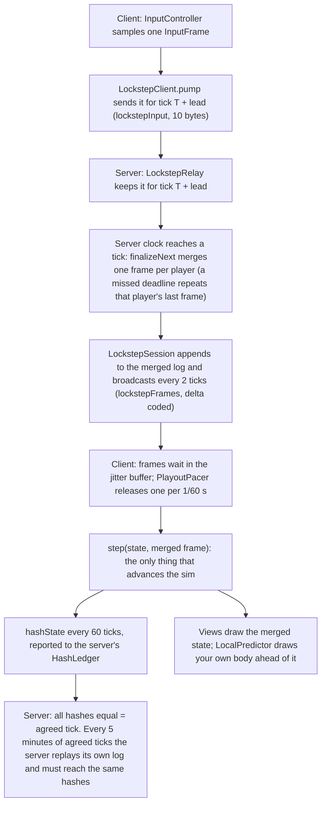

# Architecture

One page: the layers, one frame of co-op, what the server trusts, and how determinism is kept. Every claim links
to the code or the doc that backs it. Longer accounts: [`docs/SERVER.md`](docs/SERVER.md),
[`docs/CLIENT.md`](docs/CLIENT.md), the decision records in [`docs/decisions/`](docs/decisions/README.md).

## Layers

| Layer | What it is | May import |
|---|---|---|
| `shared/sim`, `shared/dungeon` | The simulation ([`step`](src/shared/sim/step.ts), [`hashState`](src/shared/sim/replay.ts)) and the floor generator. Plain TypeScript, no Roblox API, no clock, no RNG but its own seeded streams | Each other, `shared/jsmath`, generated fixtures. Nothing else |
| `shared/run` | Run configs built from a seed, recordings, validation by replay and its limits ([`index.ts`](src/shared/run/index.ts)) | sim, dungeon, feature contracts |
| `shared/lockstep` | Co-op: relay, session, hash ledger, wire format, playout pacer, input lead, prediction ([`index.ts`](src/shared/lockstep/index.ts)) | sim, run, the per-tick event types of `shared/view` |
| `shared/theme` | The theme contract: every sprite, sound, colour and string is a logical id; packs map ids to assets | config and feature data only |
| `shared/view` | Presentation math the client draws with (lerps, trackers, layouts), written pure so it runs headlessly | sim (read only), theme, config |
| `client` | Flamework controllers, the Reflex store, the React UI | `shared` |
| `server` | Flamework services and DataStores | `shared` |

What enforces it:

- **The sim's isolation is enforced twice.** ESLint ([`.eslintrc.json`](.eslintrc.json), the override for
  `src/shared/sim` and `src/shared/dungeon`) rejects Roblox globals, `os.clock` / `os.time` / `math.random`, any
  `@rbxts/*` or `@flamework/*` package, and any import outside sim, dungeon, `shared/jsmath` and the generated
  fixtures. The headless runner then loads those modules in a restricted environment where the same names raise
  `[determinism]` ([`scripts/lune/lib/realm.luau`](scripts/lune/lib/realm.luau)). Spec files are exempt from both.
- **`client` and `server` never import each other**, and `shared` never imports `server`: two
  `no-restricted-imports` overrides in the same file.
- **The rest is convention.** The directions between the other `shared` directories in the table are what the
  code does today (checked by grep, 2026-11-21), not a lint rule. No `shared` module imports `client`.

## One frame of co-op

A party run (2 to 8 players) is one simulation that every member steps from the same merged input log. The
server never steps it live.

1. **Sample.** After each stepped tick the client samples its input once
   ([`SimController`](src/client/controllers/game/SimController.ts), `InputController.sample`).
2. **Send.** [`LockstepClient.pump`](src/shared/lockstep/client.ts) sends it for tick `T + lead + buffer depth`.
   The lead is measured from the server's echo of the client's own slowest input
   ([`lead.ts`](src/shared/lockstep/lead.ts), [`docs/FRAME_PACING.md`](docs/FRAME_PACING.md) Revision 2).
3. **Merge.** On each Heartbeat [`RunSessionService`](src/server/services/RunSessionService.ts) steps the
   [`LockstepSession`](src/shared/lockstep/session.ts), whose [`LockstepRelay`](src/shared/lockstep/relay.ts)
   finalizes every tick real time has reached: each player's input for that tick, or a repeat of their last one.
   Late inputs are dropped. The merged log is the authority.
4. **Broadcast.** Merged frames go out every `BROADCAST_EVERY_TICKS` (2) ticks, delta coded per player
   ([`wire.ts`](src/shared/lockstep/wire.ts), [`config.ts`](src/shared/lockstep/config.ts)).
5. **Playout.** [`PlayoutPacer`](src/shared/lockstep/pacer.ts) steps queued frames at a steady 60 Hz from a
   jitter buffer of 3 to 12 ticks, holds when a due frame is missing, and never extrapolates.
6. **Step and hash.** The sim steps only merged frames. Every `HASH_REPORT_EVERY_TICKS` (60) ticks the client
   reports `hashState`; the [`HashLedger`](src/shared/lockstep/ledger.ts) agrees ticks in order. A lasting
   difference is a desync and the run ends unranked.
7. **Draw.** The views read the merged state. [`LocalPredictor`](src/shared/lockstep/predict.ts) replays your own
   body up to `PREDICTION.maxTicks` (20) ticks ahead from inputs already sent; a smoother in `shared/view` absorbs
   corrections. Nothing predicted reaches the sim, a hash or a remote
   ([`docs/LOCAL_PREDICTION.md`](docs/LOCAL_PREDICTION.md)).

Solo runs skip steps 2 to 5: the client steps its own input on a fixed-step loop and uploads the recording in
segments ([`docs/SERVER.md`](docs/SERVER.md) "Segmented runs").

## Trust boundary

The simulation runs on clients, so the server treats every reported result as a claim.

| The server | How | Where |
|---|---|---|
| **Recomputes** a run's hash, score, floor and summary | Replays the inputs on a world rebuilt from the seed, yielding after every 4 ms of work (`REPLAY_BUDGET_SECONDS`); the client's numbers are only compared | [`RunValidationService`](src/server/services/RunValidationService.ts), [`limits.ts`](src/shared/run/limits.ts) |
| **Owns** the co-op input log | Clients send inputs only; the relay merges them, and the server replays its own log against the hashes the clients agreed on | [`session.ts`](src/shared/lockstep/session.ts) |
| **Owns** ranked seeds and the daily seed | The server picks the seed at run start; the daily seed is derived server side | [`runSessions.ts`](src/shared/run/runSessions.ts), [`docs/DAILY.md`](docs/DAILY.md) |
| **Owns** the wallet | Every change is one `UpdateAsync` transaction on the stored document. Run grants are keyed on the server's run id, purchases on Roblox's `PurchaseId`. Both ids are kept in bounded rings (the last 64 run ids, the last 128 purchase ids), so "applied once" holds within the ring ([`trustBoundary.spec.ts`](src/shared/wallet/trustBoundary.spec.ts), [`docs/SERVER_FINDINGS.md`](docs/SERVER_FINDINGS.md) SFD1). No remote carries a balance or a price | [`WalletService`](src/server/services/WalletService.ts), [`book.ts`](src/shared/wallet/book.ts) |
| **Owns** leaderboards and personal records | Written from the replayed result of a concluded run | [`docs/SERVER.md`](docs/SERVER.md) "Leaderboards", "Personal records" |
| **Re-checks** every remote payload | Flamework type guards, then value checks and a rate limiter per remote | [`network.ts`](src/shared/network.ts) |

What it does not do ([`docs/SERVER.md`](docs/SERVER.md) "What replay validation does and does not prevent"):

- It does not detect bots or tool-assisted inputs. A recording made through the real input path is valid.
- It does not see wall time: recordings hold ticks.
- It does not verify the Codex or settings. The Codex stores what the client claims after id, size and rate
  checks; nothing rides on it.
- It cannot stop one party member from forcing a co-op run unranked (a false hash or a withheld final claim).
  It can refuse to post a score it did not replay.

## The determinism invariant

**The same seed, config and inputs produce the same `hashState` on every client, on the server, and in the
private TypeScript web build the game was ported from.** The hash is a 32-bit FNV-1a over the float64 bytes of
every state field in a fixed order ([`fixtures/hashed-fields.md`](fixtures/hashed-fields.md)). Replay validation,
co-op and the golden fixtures all rest on it.

Three things enforce it:

1. **Golden fixtures.** [`fixtures/`](fixtures/README.md) holds 16 JSON files exported from the web build. The
   parity specs replay them and compare every hash, for example
   [`runBoss.spec.ts`](src/shared/sim/runBoss.spec.ts) and [`runFull.spec.ts`](src/shared/sim/runFull.spec.ts).
2. **The runner's restricted environment.** A clock, an RNG call or a Roblox datatype in code the sim reaches
   fails the spec run, not a playtest ([`realm.luau`](scripts/lune/lib/realm.luau)).
3. **The lint.** The same rule in the editor ([`.eslintrc.json`](.eslintrc.json)); the runner stays the authority.

How new state is added: a feature's `SimConfig` field is optional, its state exists only when the field is set,
and its hash group is appended after every existing one
([`writeHashFields`](src/shared/sim/replay.ts): 6 fixture groups, then 16 port groups, each behind an
`!== undefined` check). A run without the field hashes exactly as before, so the fixtures and every earlier
world replay unchanged. Enemy archetype indices are locked by one spec
([`actors.spec.ts`](src/shared/sim/actors.spec.ts)).

## Where to go next

- Decision records: [`docs/decisions/README.md`](docs/decisions/README.md) (six short records extracted from
  the log).
- The full decision log: [`docs/DECISIONS.md`](docs/DECISIONS.md).
- Build, test and scripts: [`docs/DEVELOPING.md`](docs/DEVELOPING.md).
- Generated numbers: [`docs/FACTS.md`](docs/FACTS.md).
