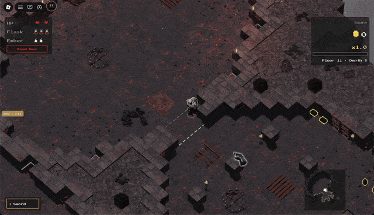

# Roblox Dungeons

A co-op bullet-hell roguelike on Roblox for up to 8 players, built on a deterministic simulation with lockstep
multiplayer. Pick a hero, dodge everything, draft boons between floors, and fight Mother Mayhem and the Demon Lord.

**[Play it on Roblox](https://www.roblox.com/games/87902875988844/Roblox-Dungeons)**



## What this is

The game began as a TypeScript web build (private) and was ported to Roblox with the requirement that the port
replay the original bit for bit. Everything since (endless floors, co-op, builds, a daily dungeon, an economy,
17 languages) sits on that deterministic core.

Written in TypeScript with roblox-ts, Flamework, Reflex and React, compiled to Luau and synced with Rojo. As of
November 2026: about 258,000 lines of source and 184,000 lines of tests in 632 spec files, all of which run
headlessly, outside Roblox Studio.

## The hard problems

### 1. A port that replays bit for bit

**Why it is hard.** Two runtimes have to produce identical 64-bit floats for a full boss fight. Luau arithmetic
is float64 but every Roblox property is float32, so a value written to a part and read back is no longer the
value computed. JavaScript's 32-bit integer semantics do not exist in Luau. Library trig differs in the last bit
between platforms.

**What was built.** The simulation is plain TypeScript with no engine types. Integer math goes through `bit32`
and a split-16-bit multiply; trig is replaced by precomputed arc tables; iteration order is fixed. The state hash
is a 32-bit FNV-1a over the little-endian float64 bytes of every field, so `0` and `-0` hash differently and so
do two values one ulp apart.

**Proof.** [`fixtures/`](fixtures/README.md) holds 16 golden files exported from the original: RNG sequences, three
dungeon layouts, bullet runs, a full 60-second run and the boss fight. The parity specs replay each one and
compare every hash ([`fixtures/hashed-fields.md`](fixtures/hashed-fields.md),
[`PROVENANCE.md`](PROVENANCE.md)).

### 2. Determinism that is enforced, not promised

**Why it is hard.** One stray `os.clock()` or `math.random()` in code the simulation reaches breaks replays,
server validation and co-op at once, and nothing fails until two machines disagree.

**What was built.** The headless test runner loads `shared/sim` and `shared/dungeon` in a restricted realm with
no Roblox datatypes, no `Instance`, and clock and RNG entry points that raise `[determinism]`. ESLint mirrors
the rule in the editor. New features add state as an opt-in config field whose hash group is appended last, so
every earlier recording still replays; enemy archetype indices are locked by one spec so no recorded index
ever moves.

**Proof.** [`scripts/lune/lib/realm.luau`](scripts/lune/lib/realm.luau),
[`src/shared/sim/actors.spec.ts`](src/shared/sim/actors.spec.ts), the rules at the top of
[`docs/DECISIONS.md`](docs/DECISIONS.md).

### 3. Co-op that feels local

**Why it is hard.** Lockstep keeps eight clients identical but shows you your own input a round trip late, and
frames arrive in bursts, so the picture moves, freezes, then jumps.

**What was built.** The server merges inputs and broadcasts finalized frames; clients step them on a playout
clock from a small jitter buffer (at least 3 ticks, 50 ms) at a steady 60 Hz. The input lead is set from
measured round trips rather than bumped on every miss, and comes back down after a spike. On top of that, your
own body is drawn up to 20 ticks ahead of the confirmed state from the inputs you already sent, with enemy
bullets drawn as far ahead, and corrected by a smoother. Hits, health and everything else stay confirmed.

**Proof.** [`src/shared/lockstep/`](src/shared/lockstep/index.ts), [`docs/FRAME_PACING.md`](docs/FRAME_PACING.md) (three
revisions, each from a measured session), [`docs/LOCAL_PREDICTION.md`](docs/LOCAL_PREDICTION.md) (signed off on
a simulated 4G link).

### 4. A server that trusts nothing

**Why it is hard.** The simulation runs on the client. Leaderboards, a daily dungeon and a currency bought with
Robux all depend on results a client reports.

**What was built.** A run is submitted as its inputs, about 5 bytes a tick, and the server replays it on a 4 ms
time budget and compares the hash and the recomputed score. In co-op, clients report state hashes at
checkpoints and the server validates its own merged log in segments. The wallet is a ledger of transactions,
never a balance a client can set, and each purchase receipt is applied once.

**Proof.** [`src/shared/run/`](src/shared/run/index.ts), [`docs/SERVER.md`](docs/SERVER.md),
[`docs/SILVER.md`](docs/SILVER.md), [`docs/SILVER_SHOP.md`](docs/SILVER_SHOP.md).

## Measured, then not built: rollback

Rollback netcode would draw the whole world ahead of the server and redo it when frames arrive. Before
building it, a spike answered two questions with numbers.

- **Can a phone afford it?** A pooled state copy brought the copy from 21-41 ms to 1-2 ms headlessly, but an
  iPhone 17 still spent 11.77 ms (p95) a frame predicting 16 ticks ahead and dropped to 50 fps. The gate was
  4 ms, set for a mid-range phone.
- **Would it look right?** In a bot sweep, teammates were corrected by a tile or more 27 to 74 times a minute
  against a gate of 6, at every prediction strategy tried.

Either result alone was disqualifying. Rollback was not built, the spike's code was removed, and local
prediction (problem 3) was built instead. The full record, including the harness design and every table, is
[`docs/ROLLBACK_SPIKE.md`](docs/ROLLBACK_SPIKE.md).

## How it stays correct at this size

`npm run verify` is the gate before every merge. Its 14 steps include:

- typecheck and lint at zero warnings;
- the headless spec suite: real Jest modules under [Lune](https://github.com/lune-org/lune), long statistical
  censuses split into shards by seed;
- `check:locals`: Luau allows 200 top-level locals per module, and this fails the build before a module gets
  there;
- `check:docs`: every export carries a doc comment, ratcheted so coverage only goes up;
- `facts:check`: the numbers the docs cite are generated ([`docs/FACTS.md`](docs/FACTS.md)), and a stale one
  fails the build;
- `check:assets`: no raw asset id outside the theme layer.

`npm run out:digest` hashes the compiled output with comments stripped, which proves a refactor or a
comment-only change did not move behaviour.

## Also in here

- **17 languages** from the Roblox cloud table, imported into validated tables, with a pseudo-locale for layout
  testing ([`docs/LOCALIZATION.md`](docs/LOCALIZATION.md)).
- **An art and audio pipeline** that builds atlases from licensed packs pinned by sha256; the raw packs are
  never committed ([`docs/ART.md`](docs/ART.md), [`THIRD_PARTY_NOTICES.md`](THIRD_PARTY_NOTICES.md)).
- **A theme contract**: every sprite, sound and string is a logical id, so art swaps without code changes.
- **Phone, gamepad and portrait play** ([`docs/MOBILE.md`](docs/MOBILE.md),
  [`docs/GAMEPAD_MENUS.md`](docs/GAMEPAD_MENUS.md), [`docs/PORTRAIT.md`](docs/PORTRAIT.md)).
- **A seeded daily dungeon** with day-scoped leaderboards ([`docs/DAILY.md`](docs/DAILY.md)).

## How this was built

By one engineer pairing with Claude, Anthropic's coding agent, over four weeks: 1,113 commits, of which 1,038
carry Claude as co-author. That pace is only safe with guardrails, and most of the tooling above exists for that
reason. The determinism realm and the golden fixtures catch a wrong simulation change mechanically. `verify`
catches the rest before a merge. Every feature starts as a written plan with numbered tasks and recorded
decisions (`docs/`, indexed in [`CLAUDE.md`](CLAUDE.md), which is also the agent's standing
instructions), and every deviation lands in the decision log.

The engineering judgment is in what the plans decided, what the gates were set to, and what was measured and
then not built.

## Run it

Requires Node 20+ and [Rokit](https://github.com/rojo-rbx/rokit).

```bash
rokit install    # rojo and lune, pinned in rokit.toml
npm install
npm test         # build, then run the headless spec suite
npm run dev      # watch build + rojo serve, then connect from Roblox Studio
```

The build and the spec suite do not need the licensed art packs. Rebuilding atlases does
([`art/README.md`](art/README.md)). Everything else a contributor needs is in
[`docs/DEVELOPING.md`](docs/DEVELOPING.md).

## Where to read next

- [`docs/DECISIONS.md`](docs/DECISIONS.md): every deviation, retune and feature entry, with what must still
  replay bit for bit.
- [`docs/SERVER.md`](docs/SERVER.md) and [`docs/CLIENT.md`](docs/CLIENT.md): the two halves as built.
- `npm run docs`: the API reference, generated from the doc comments into `build/api/`.

## Licence

Source available for review; all rights reserved. Copyright 2026 Kaleb Kougl. You may read this code to evaluate
it; it is not licensed for reuse, modification or redistribution. The full notice is in [`LICENSE`](LICENSE).

Art and audio come from third-party packs under their own licences, which this statement does not cover; see
[`THIRD_PARTY_NOTICES.md`](THIRD_PARTY_NOTICES.md).
